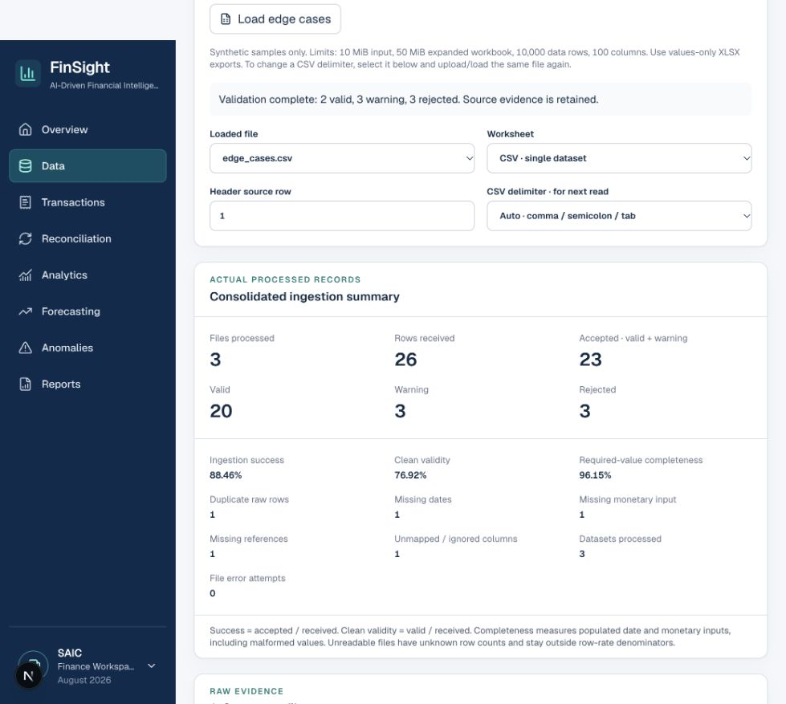
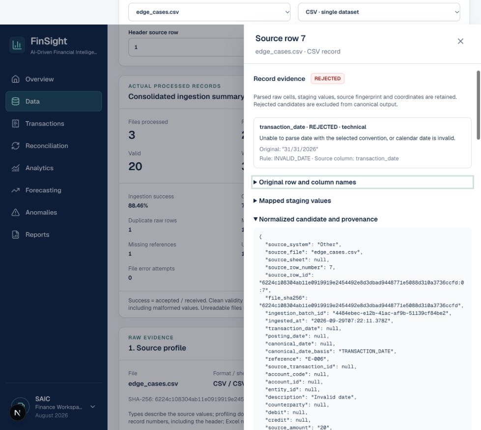

# Supervisor/client consultation demo

Use synthetic data. Open `/data` after following the root README. This page implements ingestion; other navigation pages still show mocks. The schema/rules are version 0.1 and provisional. B1/B2 changes presentation and review-state explanations only; it does not change the engine or the downstream contract.

The six numbered sections guide the current-file workflow: add a file, check its contents, confirm columns and financial conventions, approve and check, review this file's results, then review combined records and downloads. Session totals appear after the current-file work. Open **Try an example — synthetic data only** to access the three sample buttons.

| Finance label | Unchanged internal status | Inclusion |
| --- | --- | --- |
| Ready | `VALID` | Included; current ingestion checks found no active issues. This does not establish accounting correctness or reconciliation. |
| Included — needs attention | `WARNING` | Included, with all warnings retained. |
| Cannot include | `REJECTED` | Excluded; source evidence and partial candidate remain inspectable. |

## Five-minute walkthrough

| Step | Action | Visible evidence |
| --- | --- | --- |
| 1 | Add `ledger.csv` or open Try an example and click Load ledger CSV | Active filename and Review needed; 10 rows, 7 columns, original file preview and example column values. Fingerprint/inferred types are in Technical file details. |
| 2 | Review column choices and visible ledger conventions. Keep Which date should be used for these records? = Posting date. Confirm the review checkbox, then Check and add to this session. | Review confirmed — not yet checked precedes Checked; 10 Ready. The fixture has no transaction date; its posting date and explicit processing date/basis remain separate. |
| 3 | Upload/load `bank_statement.xlsx` | 2 worksheet choices; neither automatically ingested |
| 4 | Select Transactions | 8 rows, 7 different column headings; plain conflict identifies column 2 Details and column 3 Narration as both using Description. Checking is disabled. |
| 5 | Change Use Details (column 2) as to Reference | Changed by you; Narration remains Description; conflict clears. Manual method, null score and confirmation evidence remain in Column-matching technical details. |
| 6 | Review Non-negative amount plus a Debit/Credit label, date/number formats and currency; confirm and check | 8 Ready; positive source amounts and their explicit Debit/Credit labels are preserved. No universal cash-flow direction is inferred. |
| 7 | Load edge cases, leave Unmapped Note unused, confirm and check | 2 Ready, 3 Included — needs attention, 3 Cannot include. Needs review is the default filter and shows six rows. The unused column is kept in original evidence. |
| 8 | Select Cannot include · 3, then Review row for source row 7 | Plain problem, original invalid date, unavailable checked date and suggested action. Excluded candidate values are labelled preview only. Technical row evidence opens the complete original/staging/candidate, rules, mappings/options and lineage path. |
| 9 | Close row review; inspect Combined records and downloads | 23 included records, including three needing attention; no excluded rows. Compact transaction/source/status view with Review row for both source dates, chosen date, currency origin and source details; pagination 20 per page. |
| 10 | Open Quality measures and definitions, download all three reports, reload ledger, then change a column choice | Exact counts/rates; duplicate notice leaves 23 included rows. Changing the ledger removes its ten previous rows: 13 remain, confirmation clears and Needs checking again persists until review/check. Other datasets remain included. |

Expected fixture outcomes were specified independently in `public/samples/ingestion/expected.json` and verified by tests:

| Dataset | Received | Valid | Warning | Rejected | Accepted |
| --- | ---: | ---: | ---: | ---: | ---: |
| Ledger CSV | 10 | 10 | 0 | 0 | 10 |
| Bank Transactions XLSX | 8 | 8 | 0 | 0 | 8 |
| Edge-case CSV | 8 | 2 | 3 | 3 | 5 |
| **Consolidated** | **26** | **20** | **3** | **3** | **23** |

Success **88.46%**, clean validity **76.92%**, required-value completeness **96.15%**. One duplicate raw row, one missing date, one missing monetary input, one missing reference, and one ignored column. Invalid-but-populated date/amount values count as complete, not valid. No metric is labelled accuracy.

Edge rows: source row 4 repeats row 2, row 5 lacks reference, row 6 has malformed currency `MYRR` (warnings); row 7 has `31/31/2026`, row 8 has amount `twelve`, row 9 lacks both date/amount (rejections). These source rows include the header; they are not zero-based dataframe indices.

## Exports, review states and session behavior

- **Download included records — CSV** (`canonical-transactions.csv`): one line per accepted record, independent transaction/posting dates, explicit canonical date/basis, UTC ingestion timestamp, currency basis, approved zero-conversion records, source provenance, internal status and messages. The controlled demo produces **23 data rows / 31 columns**, containing `VALID` and `WARNING`. Spreadsheet-formula-like text is escaped; no rounded monetary values.
- **Download excluded-row problems — CSV** (`rejected-issues.csv`): one line per issue on a rejected record. The edge fixture has **3 excluded records but 4 report rows / 13 columns** (source row 9 has two issues). Contains original field value, rule and raw record.
- **Download full check report — JSON, technical** (`ingestion-evidence.json`): unchanged evidence bundle with versions, summary, datasets, fingerprints, sheet/header/separator, mappings/approval, conventions, full raw/staging/partial candidates, classifications and accepted canonical rows. It contains **26 processed records and 23 normalized records** for this demo. For downstream JSON consumption use **`datasets[].normalized`**, which includes `VALID` and `WARNING`. **`datasets[].records` includes rejected/evidence material and is not the default downstream input.** The public TypeScript route remains `consolidate(results).normalized`.

Refresh/navigation/**Clear this session** discards session state; download before leaving. Duplicate protection exists only in the current session. Reprocessing replaces the same file/sheet's result. Unchecked choices are not saved when switching files or worksheets; suggestions restart. Reopening a checked dataset restores its reviewed mapping/options and results. For a workbook, choose its worksheet again or use its Review checked dataset link.

Changing a column choice, financial convention or headings row removes the affected result and clears review confirmation. A persistent Needs checking again message explains the removal; other datasets remain included. A CSV separator change applies to the **next file read** and requires adding/loading that CSV again. The File-reading settings disclosure explains this distinction. Clear this session clears files, outputs and error attempts. An unreadable upload identifies the attempted filename and, if applicable, the earlier file still being displayed. No original binary download is offered because original buffers are released after parsing.

**Which date should be used for these records?** is a choice for the current dataset, not a session-wide convention. Both source dates retain their meanings. Only the selected date is required; missing/invalid selected input rejects without fallback. The combined view shows the date used and its basis; row review shows it alongside the independent Transaction date and Posting date. Currency supplied by the file versus a reviewed default, and approved blank-side-to-zero changes, remain visible in the finance view. Their exact `currency_basis` and `transformations` objects remain in Technical row evidence and exports. The three public fixtures do not need defaults or zero conversions. Required-value completeness counts presence, including malformed values, and must not be described as accuracy.

## Progressive disclosure and narrow screens

- **File-reading settings** contains headings-row and CSV-separator adjustments with explicit reread/review instructions.
- **Technical file details** retains fingerprints, inferred types and source-coordinate explanations; **Blank cells by column** retains completeness observations.
- **Column-matching technical details** retains internal target names, exact methods/scores and confirmation. Matching scores are not accounting-confidence probabilities.
- **Technical row evidence** retains original columns/cells, staging, full candidate/provenance, every rule/message, versions and reviewed mapping/options/context. Large JSON previews are capped; full evidence remains in the download.
- **Quality measures and definitions** retains the existing rates/counts and their definitions.

Below 1024 px, result/combined tables become cards with visible problem/value/review controls; column choices use one responsive set of form controls. The original file preview can still scroll sideways. Status uses text as well as color. Native disclosure summaries are keyboard accessible; row review supports Escape, Tab/Shift+Tab containment and return focus to the initiating row control.

## Supplied larger synthetic workbook

The supplied course workbook can be uploaded without copying it into Git. Choose **Transactions**, review each suggested mapping and intentionally ignore labels/auxiliary columns, then confirm **Non-negative amount plus a Debit/Credit label**. Its 6,000 positive amounts contain 4,148 Debit and 1,852 Credit directions. Never load README, GroundTruth or summary/label sheets as transaction data, or present their labels as measured reconciliation/model accuracy. The optional automated integration check verifies this source separately from the three public consultation fixtures.

## Historical pre-B1/B2 demo views

These retained screenshots show the earlier technical interface, not the current finance wording/layout. They contain only committed synthetic fixtures. Batch IDs and timestamps differ on rerun. Current B1/B2 screenshots are supplied in the independent-review ZIP under `_review_evidence/`.

## Questions to use during consultation

1. Which actual source/export and file format should be prioritized?
2. Which date (transaction/posting/value date), identifier and account fields are mandatory downstream?
3. How do sources encode debit/credit, adjustments/reversals, signed amounts and direction?
4. Are both ledger sides permitted on one row, and should exceptions warn or reject?
5. Which date/number locales and currencies/defaults are expected? Is currency mandatory?
6. Which warnings may downstream reconciliation consume, and should uncertain mappings always require approval?
7. What source retention/traceability is required, and is parsed evidence sufficient or must original files be retained?
8. What is the team's versioned canonical handoff and will later ingestion be file-based, API-based or both?

Record actual client/supervisor answers separately. This guide does not imply the consultation occurred or the schema was approved.
